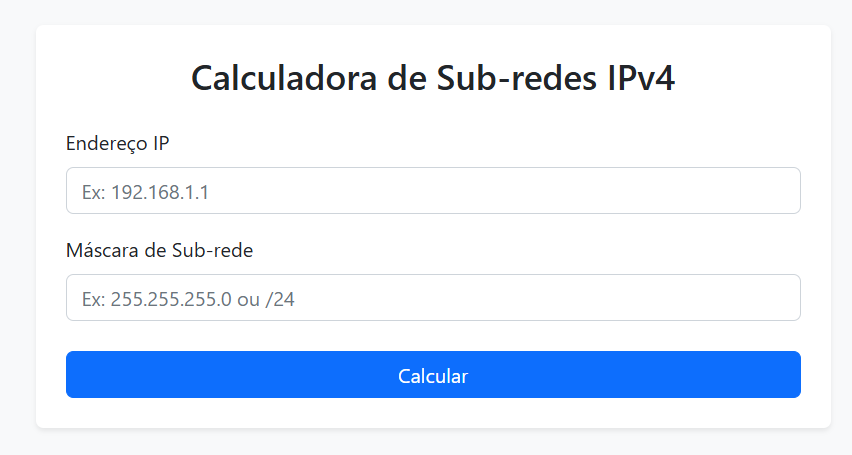
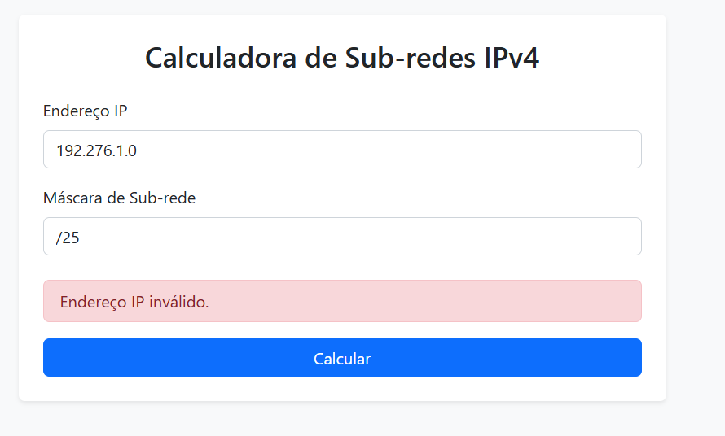
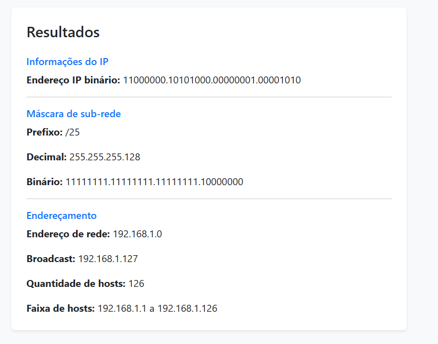

# Calculadora de Sub-redes IPv4

## Descrição

Projeto desenvolvido para calcular informações relacionadas a endereços IPv4 e suas respectivas sub-redes.

O usuário informa um endereço IP e uma máscara de sub-rede, e a aplicação realiza os cálculos e apresenta informações como endereço de rede, endereço de broadcast, quantidade de hosts disponíveis e faixa de endereços utilizáveis.

## Tecnologias

- **Python**: linguagem utilizada no backend.
- **Flask**: framework utilizado para desenvolver a API.
- **HTML**: estruturação da interface.
- **CSS / Bootstrap**: estilização e responsividade.
- **JavaScript**: comunicação com a API e atualização dinâmica da interface.

## Estrutura do projeto

```text
calculadora-subredes/
├── assets/                 # Imagens da documentação
├── src/
│   ├── static/
│   │   └── js/             # Arquivos JavaScript
│   ├── templates/          # Páginas HTML
│   │   └── index.html
│   ├── main.py             # Inicialização e rotas da API
│   ├── services.py         # Lógica de negócio e cálculos
│   └── utils.py            # Funções auxiliares
├── tests/
│   ├── data.py             # Dados utilizados nos testes
│   └── test_calcular_subredes.py
├── .gitignore
├── docker-compose.yml
├── Dockerfile
├── Makefile
├── README.md
└── requirements.txt
```

## Comandos

Os comandos abaixo são executados por meio das instruções definidas no arquivo `Makefile`.

```bash
# Iniciar os containers
make up

# Reconstruir as imagens
make build

# Parar os containers
make down

# Visualizar os logs da aplicação
make logs

# Listar os containers em execução
make ps

# Executar os testes
make tests
```

## Backend

O backend está organizado em módulos, separando as responsabilidades da aplicação:

- **main**: arquivo principal da aplicação, responsável pela configuração e definição das rotas:
  - `/`: disponibiliza a página inicial da aplicação.
  - `/health`: verifica a disponibilidade da API.
  - `/subredes`: recebe os dados enviados pelo frontend e retorna os resultados dos cálculos.
- **templates**: contém os arquivos HTML utilizados para renderizar as páginas.
- **static**: armazena os arquivos estáticos, como JavaScript e CSS.
- **services**: contém os serviços responsáveis pela lógica de negócio e pelos cálculos de sub-redes.
- **data**: contém os dados utilizados nos testes.
- **tests**: contém os testes automatizados da aplicação.

## Frontend

### Tela inicial

Na tela inicial, o usuário encontra um formulário com dois campos: endereço IP e máscara de sub-rede.



O usuário deve preencher os campos com os seguintes dados:

- **Endereço IP**: endereço IPv4 em formato decimal pontuado, composto por quatro octetos. Exemplo: `192.168.1.10`.
- **Máscara de sub-rede**: pode ser informada no formato decimal pontuado ou no formato CIDR. Exemplos: `255.255.255.0` ou `/24`.

### Dados inválidos

Caso algum dos dados informados seja inválido, a aplicação apresenta uma mensagem de erro, indicando o problema.



### Dados válidos

Quando os dados informados são válidos, a aplicação realiza os cálculos e apresenta os resultados referentes à sub-rede.



## Acessar a aplicação

Após iniciar os containers com `make up`, a aplicação estará disponível em:

[http://localhost:5000](http://localhost:5000)
